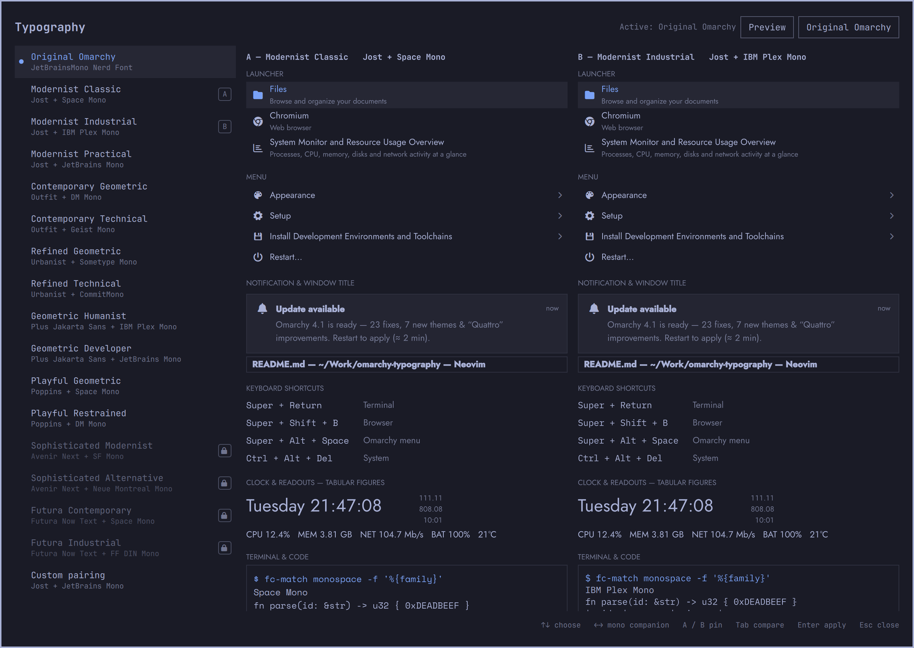

# Typography for Omarchy

Omarchy draws its whole desktop in one monospace font. This plugin splits that into two roles: a proportional geometric sans for what you read (launcher, menus, panels, window titles, optionally notifications) and a monospace for what needs fixed character cells (terminals, code, key combos). It ships 16 preset pairings, a switcher with live A/B previews inside the shell, and a one-step return to stock.



Built for Omarchy 4 (Quattro).

## Install

```bash
omarchy plugin add https://github.com/nohat/omarchy-typography
~/.config/omarchy/plugins/io.github.nohat.typography/bin/install
```

`omarchy plugin add` only clones the folder. `bin/install` is the setup step. It lists every change and asks before making any:

- downloads the open-licence fonts at pinned versions and verifies each file's SHA-256
- creates a small Python venv with pinned `fonttools` to build tabular-figure copies of Jost, Outfit and Plus Jakarta Sans
- saves a baseline copy of every config it may later change
- adds an icon fallback, a font-set hook, Appearance › Typography menu rows and a guarded Hyprland include
- enables the plugin and restarts the shell once

Nothing changes how the desktop looks until you choose a preset. No sudo or pkexec is required; everything lives in your home directory.

**Dependencies:** `jq`, `curl`, `unzip`, `python3` (with `venv`) and `fc-list`, all present on a standard Omarchy install. The network is used only while installing.

## Use

- **Menu:** Appearance › Typography › *preset*. The active one shows a ✓. **Original Omarchy** restores stock in one step.
- **Switcher:** Appearance › Typography › Compare & Switch…

  | Key | Does |
  |---|---|
  | ↑ ↓ | choose a preset; the preview follows |
  | ← → | try another monospace companion (preview only) |
  | A / B, then Tab | side-by-side comparison |
  | Enter | apply |
  | Esc | close |

- **CLI:**

  ```bash
  omarchy-typography list
  omarchy-typography set modernist-classic
  omarchy-typography custom "Jost" "Geist Mono"
  omarchy-typography stock          # Original Omarchy
  omarchy-typography doctor         # check every surface matches the selection
  omarchy-typography rescue         # shell won't come back: stock fonts, plugin off, shell restarted
  ```

Switching takes under a second and doesn't restart the shell. Your selection survives theme changes, shell restarts and logins. Running Omarchy's own `omarchy font set` while a preset is active changes only the monospace role; in Original Omarchy mode it behaves exactly as stock.

## Presets

| Preset | UI | Monospace |
|---|---|---|
| Original Omarchy | stock | stock |
| Modernist Classic | Jost | Space Mono |
| Modernist Industrial | Jost | IBM Plex Mono |
| Modernist Practical | Jost | JetBrains Mono |
| Contemporary Geometric | Outfit | DM Mono |
| Contemporary Technical | Outfit | Geist Mono |
| Refined Geometric | Urbanist | Sometype Mono |
| Refined Technical | Urbanist | Commit Mono |
| Geometric Humanist | Plus Jakarta Sans | IBM Plex Mono |
| Geometric Developer | Plus Jakarta Sans | JetBrains Mono |
| Playful Geometric | Poppins | Space Mono |
| Playful Restrained | Poppins | DM Mono |
| Sophisticated Modernist | Avenir Next | SF Mono |
| Sophisticated Alternative | Avenir Next | Neue Montreal Mono |
| Futura Contemporary | Futura Now | Space Mono |
| Futura Industrial | Futura Now | FF DIN Mono |

The last four use commercial fonts. They are never downloaded. They stay listed with a lock and refuse to apply rather than substituting something else. Import font files you hold a licence for with `omarchy-typography import <files>` and the matching presets unlock. SF Mono's licence limits it to Apple platforms. To use an explicit stand-in, run `omarchy-typography substitute <preset> <ui|mono> <family>`; the substitute is labelled everywhere it appears.

## How it works

Every shell surface takes its font from one setting, `Style.fontFamily`, which stock Omarchy points at the fontconfig `monospace` alias. The plugin's service reassigns that property from `~/.config/omarchy/typography/state.json`. Nothing under `/usr/share/omarchy` is edited, and the global `monospace` alias always names a real fixed-pitch font: the CLI refuses a proportional family for that role.

| Surface | Mechanism |
|---|---|
| Bar, launcher, panels, OSD, dialogs | service sets `Style.fontFamily`, applied live |
| Clock and readouts | tabular-figure copies of the OFL fonts (`tnum` made the default, renamed "… Tabular"), used only by the shell |
| Window titles | `~/.config/hypr/typography.lua` sets the groupbar and hyprbars font |
| GTK apps | `gsettings` `font-name` and `monospace-font-name` |
| Terminals, `monospace` | Omarchy's own `omarchy-font-set` |
| Icons | Symbols Nerd Font appended as the last fallback (it has no letters, so text is unaffected) |
| Notification text | opt-in, see below |

### Notifications (opt-in)

Omarchy's toast hardcodes `Liberation Sans`, so it can't follow the shell font. `omarchy-typography notifications on` uses `omarchy plugin clone` to replace the built-in notifier with a clone of the installed upstream in which exactly those three lines are changed (stock rendering in Original Omarchy mode). A post-update hook rebuilds the clone from the new upstream after every `omarchy update`, checks that only those lines differ, and drops the clone if the patch no longer applies. `notifications off` restores the built-in.

## Limits

- **Learn › Keybindings** aligns key chords with spaces, so its columns drift in a proportional face. Fixing that needs a monospace role in Omarchy itself.
- Shell components ask for fixed weights, so a face can't be made heavier or lighter inside the shell.
- Urbanist and Poppins have no tabular figures, so their clock digits shift width. The switcher says so.
- Jost and Poppins have taller line metrics, so toasts are slightly taller. Nothing clips.
- foot picks up a new monospace font only in new windows; Omarchy's own toast tells you so.

## Remove

```bash
omarchy-typography uninstall            # restores the saved baseline and removes fonts, hooks and menu rows
omarchy plugin remove io.github.nohat.typography
```

`uninstall` byte-compares every config it touched against the baseline and reports any file you edited in the meantime instead of overwriting it. `uninstall --purge` also deletes the baseline and venv in `~/.local/share/omarchy-typography`.

## Tests

`tests/run-all.sh` applies every preset on the live desktop. For each one it checks every surface with `doctor`, verifies the monospace family is fixed-pitch with fonttools, and captures the bar and a toast. It then confirms that stock restoration is byte-identical to the baseline.

## Licences

Code: MIT. Fonts are not stored in this repository. The installer fetches them from upstream: Jost, Outfit, Urbanist, Plus Jakarta Sans, Poppins, Space Mono, IBM Plex Mono, JetBrains Mono, DM Mono, Geist Mono, Sometype Mono (SIL OFL 1.1, via github.com/google/fonts at a pinned commit), Commit Mono (SIL OFL 1.1) and Symbols Nerd Font (MIT). The tabular-figure copies are renamed local modifications, as the OFL permits, and are never redistributed.

Built with Claude Code.
